# TalentPulse — Employee Attrition Prediction & Proactive Retention Engine

> An enterprise-grade, end-to-end Machine Learning and Browser-based AI system to predict employee turnover risk, diagnose root drivers, and provide actionable retention interventions before departure occurs.

[](LICENSE)
[](https://python.org)
[](https://jupyter.org)
[](https://scikit-learn.org)
[](https://xgboost.readthedocs.io)
[](https://www.tensorflow.org/js)
[](https://react.dev)
[](https://vitejs.dev)
[](https://vercel.com)

---

## Table of Contents

- [Overview](#overview)
- [Key Features](#key-features)
- [Project Architecture](#project-architecture)
- [Dataset & Demographics](#dataset--demographics)
- [Machine Learning Pipeline](#machine-learning-pipeline)
  - [Feature Engineering (80 Features)](#feature-engineering-80-features)
  - [Hyperparameter Optimization & Ensembles](#hyperparameter-optimization--ensembles)
  - [Dual Operational Threshold Modes](#dual-operational-threshold-modes)
- [Model Performance Matrix](#model-performance-matrix)
- [EDA Statistical Summary (`reports/eda_summary.json`)](#eda-statistical-summary-reportseda_summaryjson)
- [Reports & Visual Diagnostics](#reports--visual-diagnostics)
- [Model Metadata (`model_metadata.json`)](#model-metadata-model_metadatajson)
- [Client-Side Web Application (`web/`)](#client-side-web-application-web)
- [How to Run Locally](#how-to-run-locally)
- [Vercel Deployment Guide](#vercel-deployment-guide)
- [License](#license)
- [Author](#author)

---

## Overview

Employee turnover creates substantial organizational disruption, including institutional knowledge loss, lowered team morale, and recruitment costs typically ranging from **50% to 200% of an employee's annual salary**. 

**TalentPulse** addresses this challenge through a rigorous two-tier architecture:
1. **Offline Training & Research Pipeline:** A leak-free Python pipeline with Power Transformations (Yeo-Johnson), class-imbalance weighting, Bayesian/Randomized Hyperparameter Optimization (HPO), 10-fold Out-Of-Fold (OOF) cross-validation, and Stacking/Soft-Voting Ensembles.
2. **Client-Side Edge Web App:** A zero-backend React 19 + TypeScript web application powered by **TensorFlow.js** (distilled MLP ensembles and exact Logistic Regression weights). Predictions execute in **under 5 ms inside the client's browser**, guaranteeing 100% data privacy — **zero employee records or PII ever leave the user's screen**.

---

## Key Features

- **Champion Stacking Ensemble:** Meta-learner combining Logistic Regression, Random Forest, XGBoost, Extra Trees, Gradient Boosting, and Calibrated RBF-SVC achieving **0.8527 OOF ROC-AUC** and **0.8345 Holdout Test ROC-AUC** with lowest Brier calibration error (**0.0986**).
- **Hardcoded Balanced Class Weights:** Direct weighting ($w_0 = 0.5963$, $w_1 = 3.0947$) ensures that minority turnover cases are not swamped by the 83.9% majority retention class.
- **Dual Threshold Strategy:** HR teams can toggle between **Balanced $F_1$ Mode** and **High-Recall Early Warning Mode** (catching up to **70.2%** of actual leavers).
- **Client-Side TensorFlow.js Inference:** Distilled MLP models and analytical weights (~130 KB total) run completely on-device with zero API latency and zero cloud compute costs.
- **Plain-Language Human UI:** Warm, non-technical interface with accessible word-based ratings, 1-tap realistic employee presets, dual-indicator semantic colors (safe green, watch amber, high-risk coral red), and concrete managerial action checklists.
- **Audit & Subgroup Diagnostics:** Comprehensive reports covering demographics, feature importance consensus, ROC/PR curves, threshold sweeps, calibration reliability, and subgroup parity.

---

## Project Architecture

```
TalentPulse/
├── data/
│   ├── employee_attrition.csv               # Raw IBM HR dataset (1,470 records, 35 columns)
│   ├── cleaned_employee_attrition.csv       # Preprocessed base dataset
│   └── training_dataset.csv                 # Feature-engineered training table
│
├── models/
│   ├── logistic_regression_model.pkl        # Tuned Logistic Regression with hardcoded weights
│   ├── random_forest_model.pkl              # Tuned Random Forest Classifier
│   ├── xgb_model.pkl                        # Tuned XGBoost Classifier
│   ├── voting_ensemble_model.pkl            # Soft Voting Ensemble
│   ├── stacking_ensemble_model.pkl          # Champion Stacking Ensemble
│   ├── best_pipeline.pkl                    # Production Sklearn inference pipeline
│   ├── scaler.pkl                           # Fitted preprocessing transformer
│   └── model_metadata.json                  # Complete audit record of parameters & metrics
│
├── reports/
│   ├── eda_summary.json                     # Statistical summary of EDA & feature correlations
│   └── plots/                               # 11 Publication-quality visual analysis charts
│       ├── 01_eda_target_and_demographics.png
│       ├── 02_eda_income_tenure_satisfaction.png
│       ├── 03_eda_interactions_and_correlations.png
│       ├── 04_eda_feature_distributions.png
│       ├── 05_eda_engineered_features.png
│       ├── 06_feature_importance_multi_model.png
│       ├── 07_model_comparison_metrics.png
│       ├── 08_model_comparison_radar_and_ensemble.png
│       ├── 09_roc_pr_and_threshold_curves.png
│       ├── 10_confusion_matrices_comparison.png
│       └── 11_calibration_and_subgroup_audit.png
│
├── notebooks/
│   ├── EDA.ipynb                            # Comprehensive exploratory data analysis
│   ├── TRAINING.ipynb                       # Model benchmarking & HPO experiments
│   ├── REPORT.ipynb                         # Visual reports & business narrative
│   ├── feature_engineering.ipynb            # Dedicated feature engineering notebook
│   └── train_pipeline.ipynb                 # 7-stage automated training pipeline notebook
│
├── web/                                     # React 19 + TensorFlow.js Production Frontend
│   ├── public/models/                       # Exported browser AI models & preprocessor JSONs
│   │   ├── preprocessor.json                # Yeo-Johnson lambdas, OHE schemas & medians
│   │   ├── dashboard_data.json              # Evaluated metrics, ROC points & EDA facts
│   │   └── tfjs/                            # Exported TensorFlow.js model topologies & weights
│   │       ├── logistic_regression/
│   │       ├── stacking_ensemble/
│   │       ├── xgboost/
│   │       └── random_forest/
│   ├── src/                                 # Component-driven React source code
│   ├── package.json                         # Web dependencies (TF.js, Framer Motion, GSAP, Recharts)
│   └── vite.config.ts                       # Code-split bundler configuration
│
├── feature_engineering.py                   # Reusable leak-free scikit-learn transformers
├── train_pipeline.py                        # 7-Stage CLI pipeline script with live ANSI progress
├── export_tfjs.py                           # Python-to-TensorFlow.js distillation & export utility
├── vercel.json                              # Root Vercel SPA build & cache configuration
├── .vercelignore                            # Exclusion list for lightweight Vercel deployment
├── requirements.txt                         # Python pipeline dependencies
├── LICENSE                                  # MIT License
└── README.md
```

---

## Dataset & Demographics

The dataset is derived from the standard IBM HR Analytics Employee Attrition benchmark:

| Attribute | Specification |
|:---|:---|
| **Total Cohort** | 1,470 employee records |
| **Train / Test Partition** | 1,176 training rows (80%) / 294 holdout test rows (20%) stratified |
| **Target Variable** | `Attrition` (Binary: `0 = Stayed`, `1 = Departed`) |
| **Class Distribution** | 1,233 Stayed (83.88%) vs 237 Left (16.12%) |
| **Imbalance Ratio** | **5.20 : 1** majority-to-minority ratio |

---

## Machine Learning Pipeline

### Feature Engineering (80 Features)

The pipeline transforms 18 base HR indicators into **80 modeling features** using domain-driven, leak-free transformations:
- **Tenure & Career Ratios:** `TenurePerJob`, `RoleTenureRatio`, `TenureToAgeRatio`, `PromotionStagnationIndex`, `ManagerTenureRatio`.
- **Compensation Parity:** `IncomePerWorkingYear`, `IncomeToAgeRatio`, `IncomeVsRoleMedian` (normalized against departmental benchmarks).
- **Fatigue & Interaction Flags:** `BurnoutIndex` (Overtime weighted by distance and inverse satisfaction), `TotalSatisfactionScore`, `Overtime_x_Single`, `Overtime_x_NoStock`, `Overtime_x_LowIncome`.
- **Preprocessing Transformers:** `PowerTransformer(method='yeo-johnson')` for skewed numerical variables, `OneHotEncoder(handle_unknown='ignore')` for nominal categories, and `StandardScaler` fitted exclusively on training folds.

### Hyperparameter Optimization & Ensembles

Evaluated across 6 foundational algorithms and 3 ensemble architectures using 5-fold cross-validation:
1. **Logistic Regression (ElasticNet):** Calibrated with hardcoded inverse frequency weights ($w_0 = 0.5963$, $w_1 = 3.0947$).
2. **Random Forest:** 449 entropy-based trees with balanced subsampling.
3. **XGBoost:** Gradient boosted trees with subsampling and scale-weight tuning.
4. **Extra Trees & Gradient Boosting:** Diverse tree ensembles for variance reduction.
5. **Calibrated RBF Support Vector Machine:** Sigmoid-calibrated non-linear separator.
6. **Weighted Soft-Voting Classifier:** Blended predictions with weights optimized via grid search.
7. **Stacking Classifier (Champion):** Meta-logistic regression trained on 10-fold Out-Of-Fold probability outputs.

---

## Model Performance Matrix

Evaluated on the **unseen holdout test set (294 records, 47 actual leavers)** across both operational decision thresholds:

### 1. High-Recall Early Warning Mode (HR Retention Priority)
*Optimized threshold ($\tau$) to capture maximum leavers early for proactive HR check-ins:*

| Model | Alert Threshold ($\tau$) | Accuracy | Recall | Precision | $F_1$ Score | ROC-AUC | PR-AUC | Brier Error |
|:---|:---:|:---:|:---:|:---:|:---:|:---:|:---:|:---:|
| **Stacking Ensemble (Champion)** | `0.245` | **85.7%** | 59.6% | 54.9% | 0.5714 | **0.8345** | **0.5626** | **0.0986** |
| **Weighted Soft-Vote Ensemble** | `0.260` | 84.7% | 66.0% | 51.7% | **0.5962** | 0.8284 | 0.5492 | 0.1004 |
| **Logistic Regression** | `0.640` | 86.7% | 59.6% | **58.3%** | 0.5895 | 0.8339 | 0.5961 | 0.1462 |
| **XGBoost** | `0.260` | 83.3% | 63.8% | 48.4% | 0.5660 | 0.8058 | 0.5118 | 0.1050 |
| **Random Forest** | `0.400` | 80.6% | **70.2%** | 44.0% | 0.5410 | 0.7977 | 0.4866 | 0.1331 |

### 2. Balanced $F_1$ Mode
*Equal balance between precision and recall:*

| Model | Alert Threshold ($\tau$) | Accuracy | Recall | Precision | $F_1$ Score | ROC-AUC |
|:---|:---:|:---:|:---:|:---:|:---:|:---:|
| **Stacking Ensemble** | `0.330` | **86.1%** | 51.1% | **57.1%** | 0.5393 | **0.8345** |
| **Logistic Regression** | `0.735` | 86.1% | 51.1% | 57.1% | 0.5393 | 0.8339 |
| **Weighted Soft-Vote** | `0.300` | 86.1% | **59.6%** | 56.0% | **0.5773** | 0.8284 |
| **Gradient Boosting** | `0.305` | 86.4% | 51.1% | 58.5% | 0.5455 | 0.8173 |

---

## EDA Statistical Summary (`reports/eda_summary.json`)

The statistical findings from [`reports/eda_summary.json`](reports/eda_summary.json) summarize the raw cohort patterns:

- **Cohort Shape:** 1,470 employee records across 35 original fields (0 missing values, 0 duplicate records).
- **Constant Columns Removed:** `EmployeeCount`, `Over18`, `StandardHours` (0 variance).
- **ID Columns Excluded:** `EmployeeNumber` (unique identifier).
- **Class Balance:** 1,233 retained (83.88%), 237 churned (16.12%), imbalance ratio = **5.203**.
- **Top Categorical Risk Associations (Cramér's $V$ & $\chi^2$):**
  - **OverTime:** $\chi^2 = 87.56$, $p = 8.16 \times 10^{-21}$, Cramér's $V = 0.244$ (Yes: **30.5%** vs No: **10.4%**).
  - **JobRole:** $\chi^2 = 86.19$, $p = 2.75 \times 10^{-15}$, Cramér's $V = 0.242$ (Sales Rep: **39.8%** vs Research Director: **2.5%**).
  - **MaritalStatus:** $\chi^2 = 46.16$, $p = 9.46 \times 10^{-11}$, Cramér's $V = 0.177$ (Single: **25.5%** vs Divorced: **10.1%**).
  - **BusinessTravel:** $\chi^2 = 24.18$, $p = 5.61 \times 10^{-6}$, Cramér's $V = 0.128$ (Frequent Travel: **24.9%** vs Non-Travel: **8.0%**).
- **Top Numerical Risk Associations (Mann-Whitney $U$ & Point-Biserial $r$):**
  - **TotalWorkingYears:** Point-biserial $r = -0.171$, $p = 2.40 \times 10^{-14}$ (Mean Stay: **11.86 yrs** vs Leave: **8.24 yrs**).
  - **JobLevel:** Point-biserial $r = -0.169$, $p = 2.96 \times 10^{-13}$ (Mean Stay: **2.15** vs Leave: **1.64**).
  - **YearsInCurrentRole:** Point-biserial $r = -0.161$, $p = 4.43 \times 10^{-12}$ (Mean Stay: **4.48 yrs** vs Leave: **2.90 yrs**).
  - **MonthlyIncome:** Point-biserial $r = -0.160$, $p = 2.95 \times 10^{-14}$ (Mean Stay: **$6,832** vs Leave: **$4,787**).
  - **YearsAtCompany:** Point-biserial $r = -0.134$, $p = 2.92 \times 10^{-13}$ (Mean Stay: **7.37 yrs** vs Leave: **5.13 yrs**).

---

## Reports & Visual Diagnostics

The automated pipeline generates **11 publication-grade figures** stored under [`reports/plots/`](reports/plots/). All plots are rendered below:

### 1. Target Distribution & Demographic Breakdown
Analysis of overall class balance, attrition proportion, age distribution, and gender breakdowns.
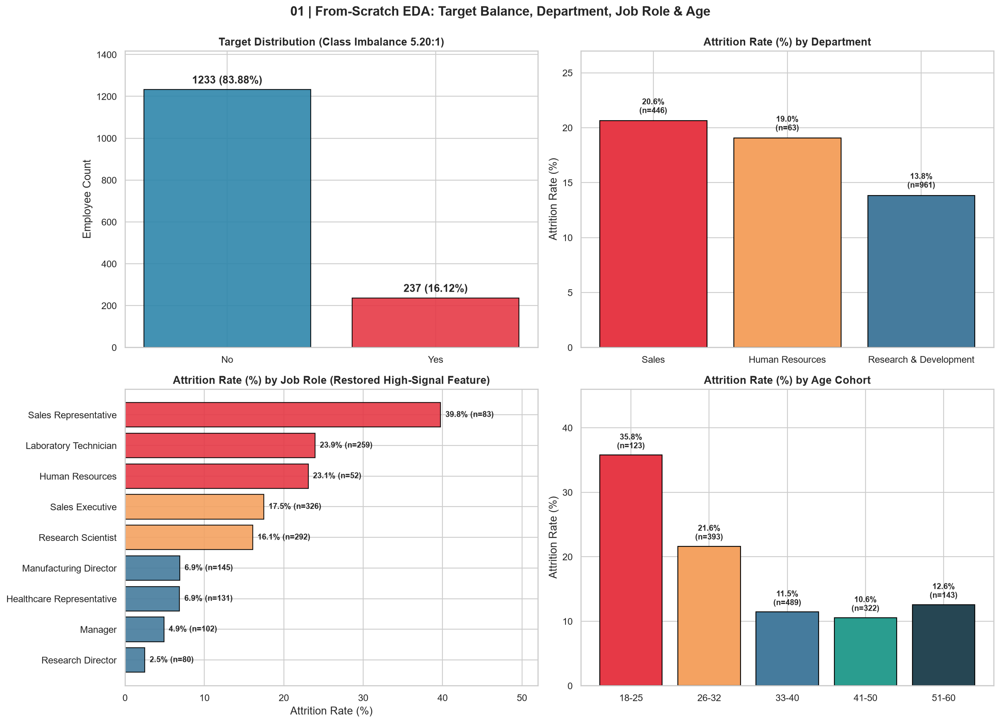

### 2. Income, Tenure & Satisfaction Distributions
Violin and box plots contrasting compensation and tenure levels between retained and departed employees.
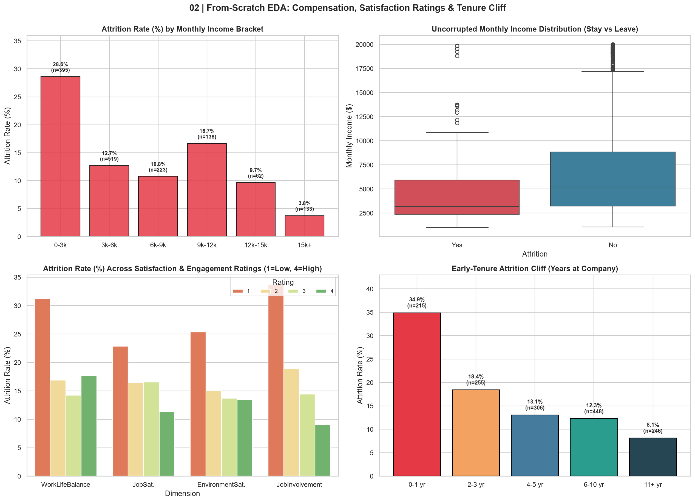

### 3. Interactions & Correlation Heatmaps
Correlation matrix of high-risk factors and bivariate interactions between overtime, marital status, and stock options.
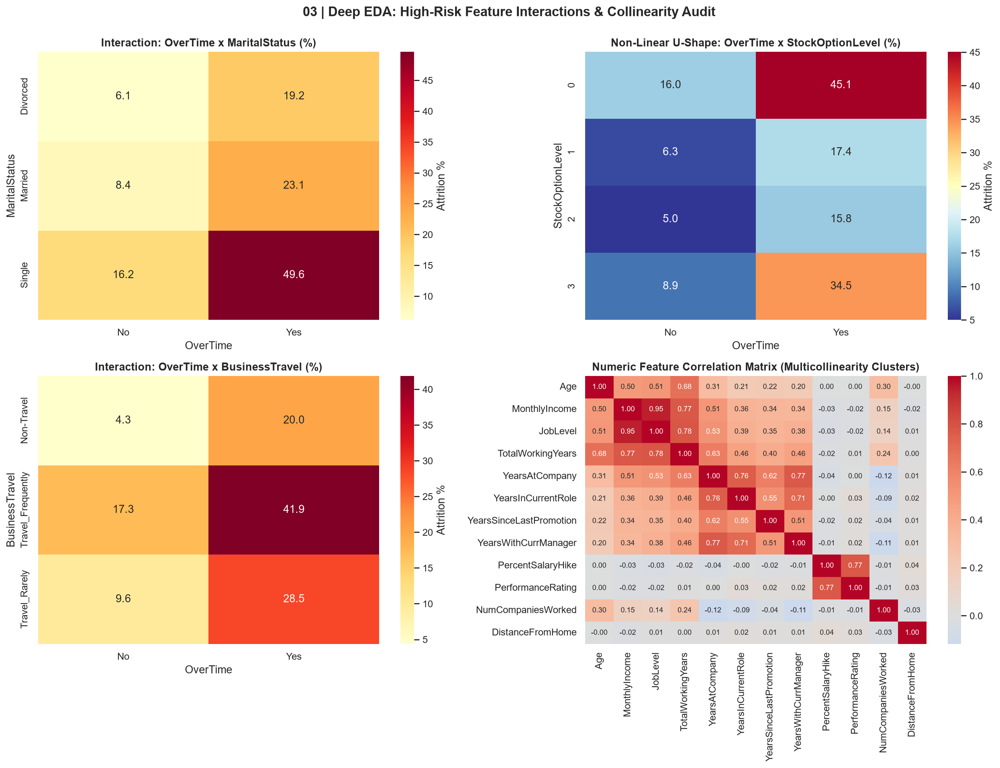

### 4. Raw Feature Distributions & Skewness
Distribution profiles and skewness assessment across numerical features prior to power transformations.
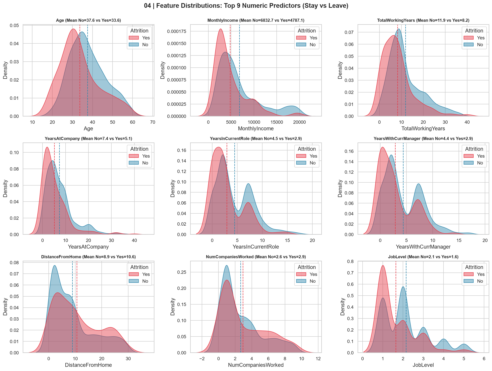

### 5. Engineered Domain Features
Impact of tenure ratios, compensation parity benchmarks, and fatigue indices on turnover likelihood.
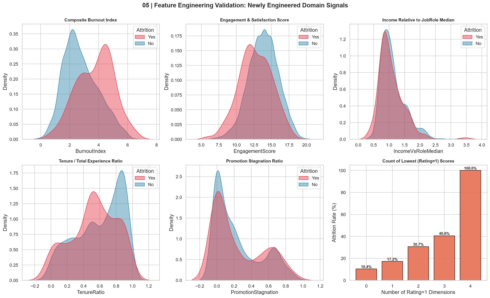

### 6. Consensus Feature Importance Across Models
Normalized importance scores comparing tree split importance, regression coefficients, and permutation impact.
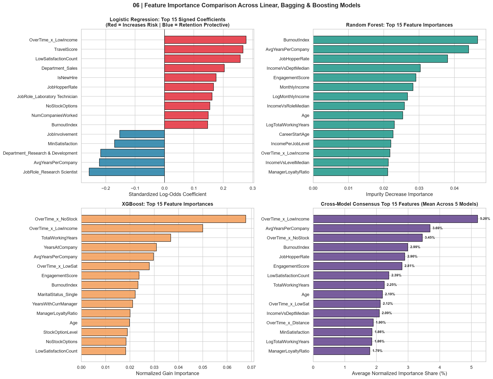

### 7. Multi-Model Performance Comparison
Comparison of Accuracy, Recall, Precision, $F_1$, and ROC-AUC on holdout validation data.
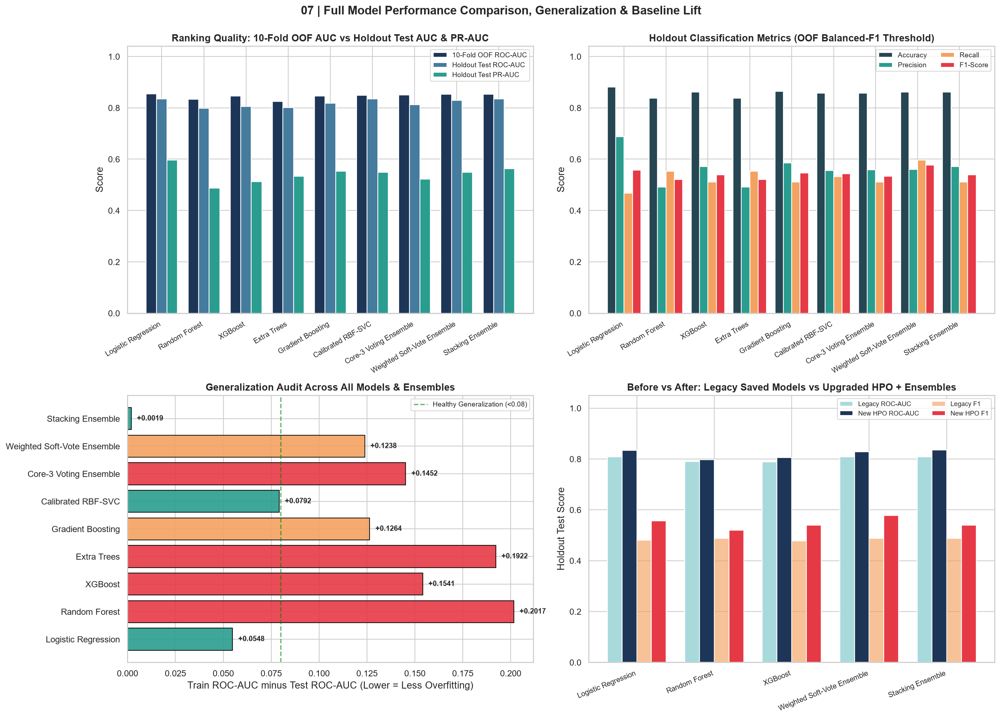

### 8. Model Radar & Ensemble Architecture
Trade-off radar chart across evaluation axes and schematic of the Champion Stacking ensemble.
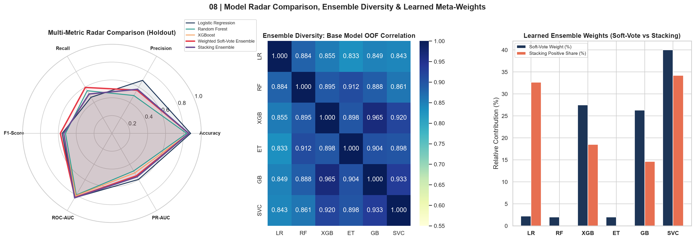

### 9. ROC, Precision-Recall & Threshold Sweeps
Receiver Operating Characteristic and PR curves with optimal operational threshold markers.
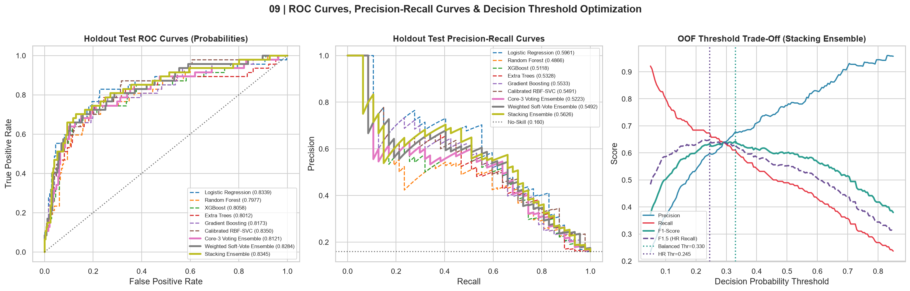

### 10. Confusion Matrix Comparison
Side-by-side confusion matrices for all evaluated models under standard vs high-recall threshold settings.
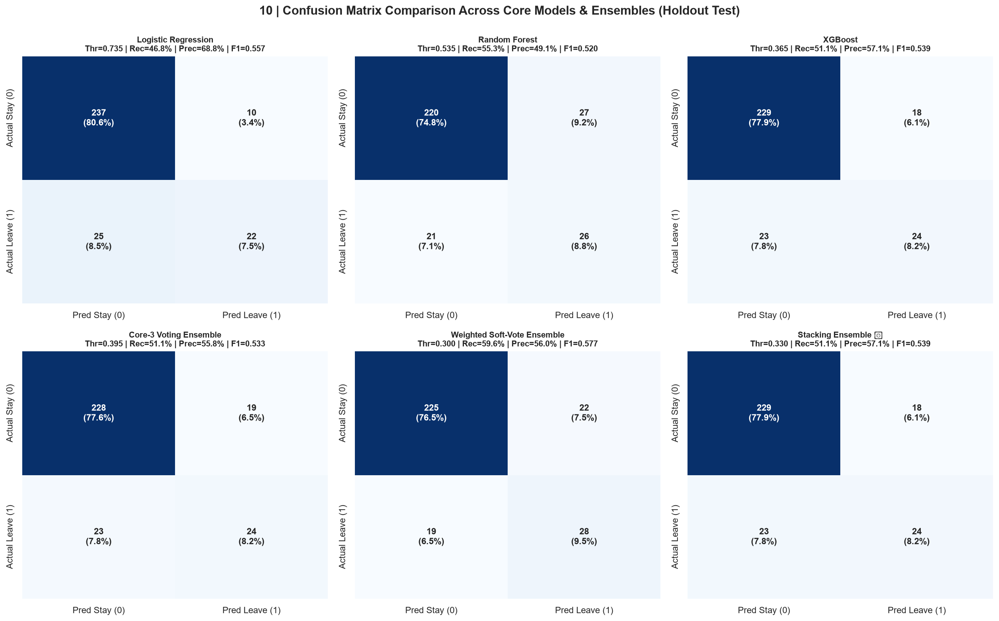

### 11. Calibration Curves & Demographic Subgroup Audit
Brier score calibration reliability curves and fairness/subgroup error rate parity analysis.
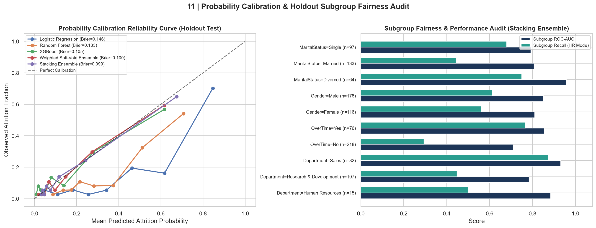

---

## Model Metadata (`model_metadata.json`)

The file [`models/model_metadata.json`](models/model_metadata.json) serves as the **single source of truth** for model reproducibility and system transparency. It records:
- **Environment & Package Versions:** Python 3.14.10, Scikit-Learn 1.9.0, XGBoost 3.3.0, NumPy 2.5.0, Pandas 3.0.3.
- **Pipeline Hyperparameters:** Best parameters found for all 6 models via randomized search.
- **Ensemble Coefficients:** Stacking meta-learner weights and soft-voting weights.
- **Cross-Validation Logs:** 10-fold Out-Of-Fold ROC-AUC, PR-AUC, Log-Loss, and runtime benchmarks.
- **Holdout Test Confusion Matrices:** Exact True Negatives, False Positives, False Negatives, and True Positives for both threshold modes.
- **Consensus Feature Drivers:** Top positive and negative coefficients enabling plain-language explanations in the web UI.

---

## Client-Side Web Application (`web/`)

The web frontend located in [`web/`](web/) is a standalone React 19 application configured for seamless static hosting:
- **Client-Side TensorFlow.js Engine:** Loads `preprocessor.json` and distilled MLP topologies (`models/tfjs/`) to compute instant retention scores directly on the user's CPU/GPU.
- **Non-Technical Interface:** Designed so that any non-technical manager can evaluate a worker without encountering ML jargon. Ratings are intuitive plain words (*Unhappy*, *Okay*, *Happy*, *Very happy*).
- **Interactive GSAP Retention Dial:** Real-time animated needle and probability sweep with instant feedback.
- **3 Signs at a Glance:** Visual status meters for *Daily happiness*, *Pay vs teammates*, and *Hours and strain*.
- **Managerial Action Playbook:** Automatically suggests prioritized retention steps (*e.g., reallocate overtime, schedule 1-on-1 check-in, review market salary*).
- **Second Opinion (4 Checks):** Collapsible drawer showing consensus across *Main result*, *Everyday balance check*, *Stress-pair check*, and *Extra-careful check*.

---

## How to Run Locally

### 1. Python ML Pipeline & Notebooks

Clone the repository and set up a virtual environment:

```bash
git clone https://github.com/alokprasad573/TalentPulse.git
cd TalentPulse

python -m venv .venv
# Windows:
.venv\Scripts\activate
# macOS/Linux:
source .venv/bin/activate

pip install -r requirements.txt
```

To run the automated 7-stage ML training pipeline:

```bash
python train_pipeline.py
```

To re-export TensorFlow.js browser weights:

```bash
python export_tfjs.py
```

To explore Jupyter Notebooks:

```bash
jupyter notebook
```

### 2. React + TensorFlow.js Web Application

Navigate to the `web/` directory:

```bash
cd web
npm install
npm run dev
```

Open `http://localhost:5173` in your browser.

To build the optimized production bundle:

```bash
npm run build
```

---

## Vercel Deployment Guide

TalentPulse is fully pre-configured for static edge deployment on **Vercel** with zero server-side Python overhead:

1. **Root `vercel.json` Configuration:** Automatically instructs Vercel to install web dependencies (`npm --prefix web ci`), build the bundle (`npm --prefix web run build`), and serve from `web/dist`.
2. **Static Asset Caching:** Models and assets are served with immutable 1-year cache headers (`Cache-Control: public, max-age=31536000, immutable`).
3. **Deployment Steps:**
   - Push your changes to GitHub.
   - Import the repository in [Vercel Dashboard](https://vercel.com/new).
   - Vercel will auto-detect the root `vercel.json` and deploy immediately.
   - Or deploy via CLI:
     ```bash
     npx vercel --prod
     ```

---

## License

This project is licensed under the **MIT License** — see the [LICENSE](LICENSE) file for complete details.

---

## Author

**Made with love by Alok Prasad**  
*Machine Learning Engineer & Full-Stack Developer*  
GitHub: [@alokprasad573](https://github.com/alokprasad573)
